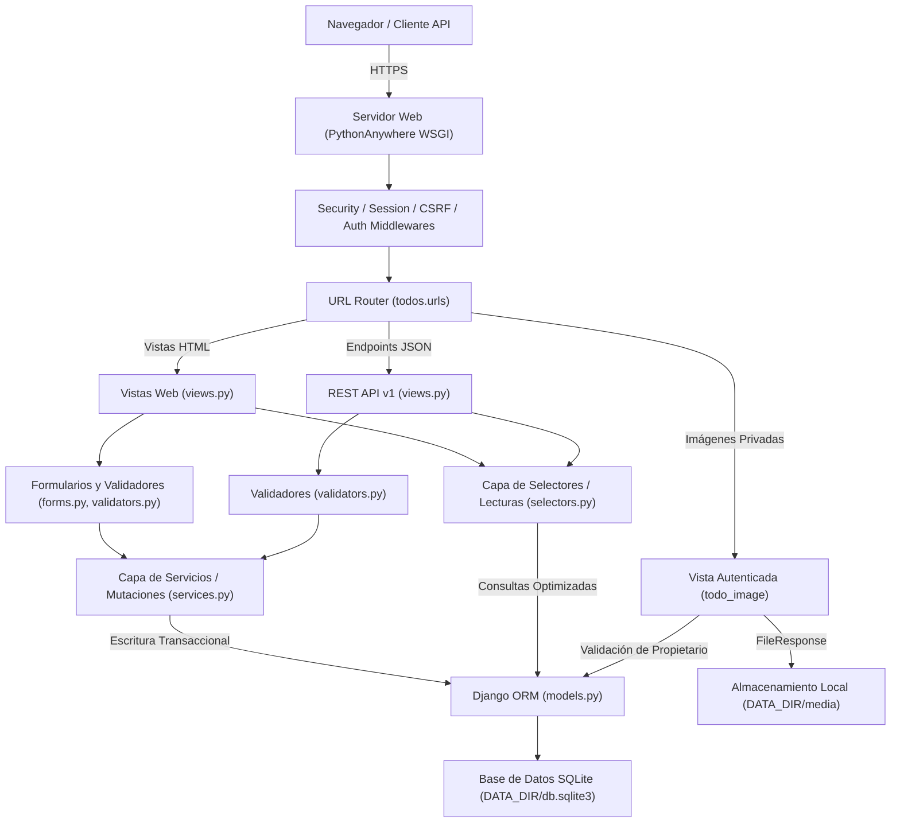

# Arquitectura del Sistema — TaskPilot

TaskPilot es un monolito web moderno basado en el patrón **MVT (Model-View-Template)** con una arquitectura limpia de separación de responsabilidades (CQRS ligero: división entre consultas y mutaciones) optimizado para despliegues de bajo costo y alta confiabilidad en entornos como **PythonAnywhere**.

---

## 1. Diagrama de Arquitectura

---

## 2. Capas del Sistema

### 2.1 Modelo de Datos (`todos/models.py`)
- Modelo central: `TodoTask`.
- Relación obligatoria `ForeignKey(User, on_delete=models.CASCADE, related_name="todos")` que garantiza la titularidad estricta de cada tarea.
- Campos de metadatos: `title`, `description`, `priority` (`baja`, `media`, `alta`), `category`, `completed`, `due_date`, `image`, `created_at`, `updated_at`.
- Método `to_dict()`: Serialización a diccionario con resolución dinámica de URLs privadas (`reverse('todo_image', ...)`), sin exponer rutas absolutas en disco.

### 2.2 Capa de Consultas y Lecturas (`todos/selectors.py`)
- Responsable exclusivamente de recuperar datos sin alterar el estado.
- Métodos principales:
  - `_user_todos(user)`: Filtro base obligatorio que restringe toda consulta a `user=request.user`.
  - `list_todos_queryset(...)`: Construcción de querysets con filtros de estado (`pending`, `completed`), prioridad, categoría y búsqueda textual.
  - `paginate_queryset(queryset, page, per_page)`: Paginación segura con manejo de páginas fuera de rango.
  - `get_todo(todo_id, user)`: Obtención de tarea individual aislada por usuario.
  - `get_categories(user)` y `get_stats(user)`: Métricas y categorías personalizadas por usuario.

### 2.3 Capa de Servicios y Mutaciones (`todos/services.py`)
- Responsable de todas las operaciones de modificación de estado.
- Ejecución transaccional atómica (`@transaction.atomic`) en `create_todo`, `update_todo`, `toggle_todo` y `delete_todo`.
- Gestión de ciclo de vida de archivos adjuntos: eliminación automática de imágenes anteriores al reemplazarlas o al borrar la tarea.
- Conversión segura de tipos: utiliza `parse_bool` para evitar evaluar la cadena `"false"` como `True`.

### 2.4 Validación e Integridad (`todos/forms.py` y `todos/validators.py`)
- `validate_task_image`: Inspección real del encabezado y contenido mediante Pillow (`Image.verify()`), límite de 5 MB y formatos permitidos (`JPEG`, `PNG`, `WEBP`, `GIF`).
- `TaskForm`: Validación de longitud de títulos (máx. 200 caracteres, no vacíos) y sanitización de entradas.

### 2.5 Capa de Vistas (`todos/views.py`) y URLs (`todos/urls.py`)
- **Vistas Web:** Renderizado de plantillas con Tailwind CSS; redirección al login ante usuarios anónimos (`@login_required`).
- **API REST v1:** Respuestas estructuradas en JSON; respuesta `401 Unauthorized` JSON para usuarios no autenticados (`@api_login_required`), sin redirecciones HTML; soporte de paginación (`?page=1&per_page=10`).
- **Entrega de Multimedia Privada (`todo_image`):** Inspecciona que el usuario autenticado sea propietario de la tarea o miembro del `staff`, sirviendo el archivo mediante `FileResponse` sin exponer la ruta interna.

---

## 3. Persistencia y Despliegue en PythonAnywhere

- **Motor:** SQLite relacional nativo gestionado por Django ORM.
- **Configuración de Bloqueo:** `OPTIONS: {"timeout": 20}` en `config/settings.py` para prevenir `OperationalError: database is locked` en almacenamiento de red.
- **Sin WAL (Write-Ahead Logging):** SQLite en sistemas de archivos compartidos (NFS de PythonAnywhere) opera de forma más estable en modo journal tradicional (`delete`/`truncate`), manteniendo transacciones cortas y atómicas.
- **Desacoplamiento de Datos (`DATA_DIR`):** La base de datos y la multimedia residen en `DATA_DIR` (`/home/<usuario>/taskpilot-data`), separadas del código fuente del repositorio (`/home/<usuario>/taskpilot`).
